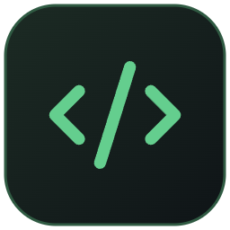
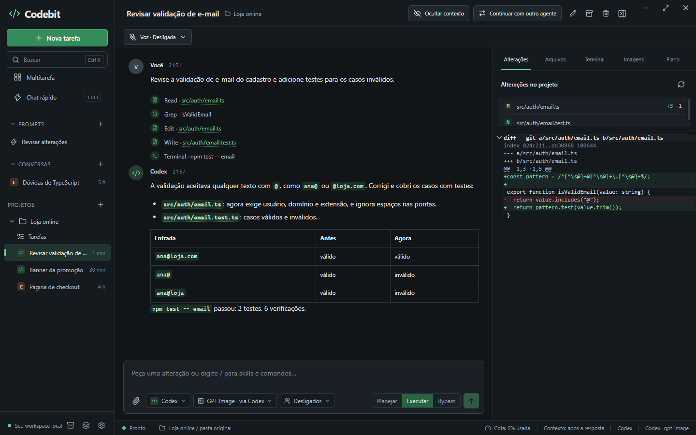
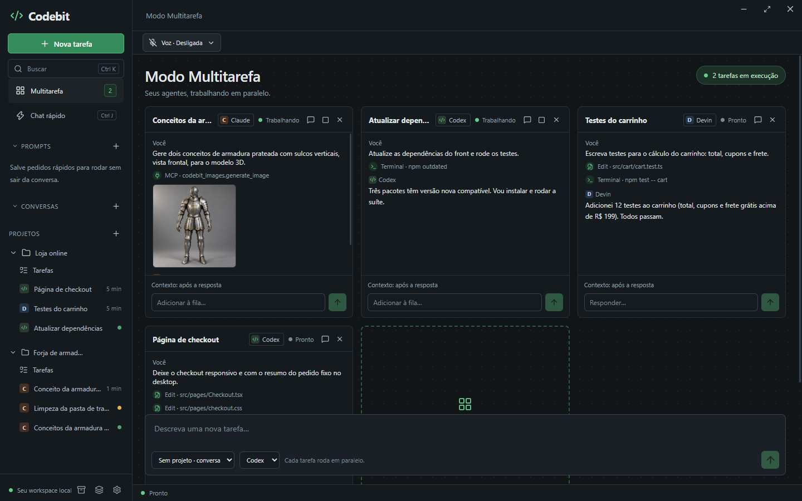
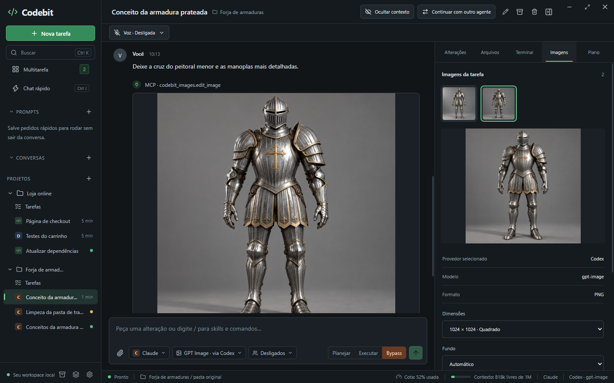
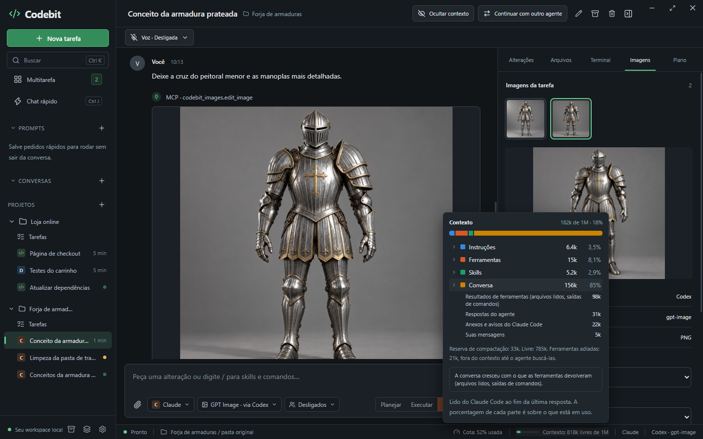
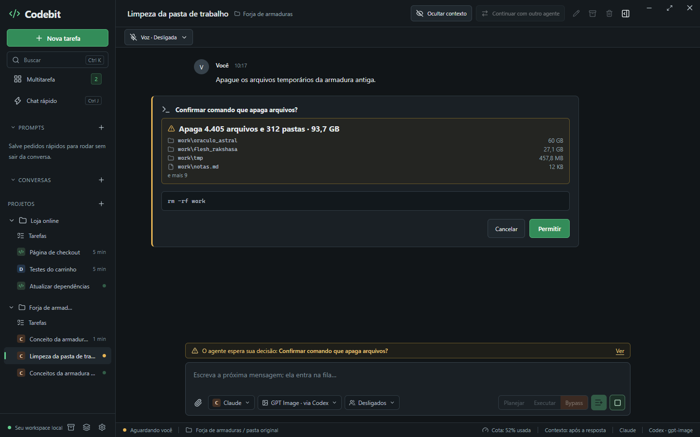

<div align="center">



# Codebit

**Seus agentes de código numa janela só.**

Codex, Claude Code e Devin lado a lado: conversas, tarefas em paralelo, imagens e travas de segurança,<br />
com os CLIs e os planos que você já tem.

[Instalar](#instalação) · [O que ele faz](#o-que-ele-faz) · [Guia completo](docs/GUIA.md)


</div>



## Por que o Codebit

- **Um lugar para todos os agentes.** Comece com o Claude, passe para o Codex no meio da conversa e volte. Cada agente retoma a própria sessão e recebe o que perdeu.
- **Nada de conta nova.** O Codebit não tem servidor nem telemetria. Ele usa os CLIs instalados na sua máquina, com os logins e as assinaturas que você já paga.
- **Trabalho em paralelo de verdade.** Várias conversas ao mesmo tempo, sub-agentes que dividem um trabalho grande, uma fila de mensagens enquanto o agente responde.
- **Seguro por padrão.** Antes de um comando que apaga muito, você vê o alcance e decide. Um agente que insiste no que não funciona é parado. Chaves de API ficam cifradas.

## O que ele faz

### Vários agentes trabalhando ao mesmo tempo

O **Multitarefa** põe as conversas lado a lado: cada cartão mostra o que o agente está fazendo, as imagens geradas e os pedidos de aprovação, que dá para responder ali mesmo. Com os **sub-agentes**, o agente principal divide um pedido grande e entrega as partes a outros agentes, com o CLI e o modelo que você escolher.



### Imagens dentro da conversa

Peça uma imagem e ela aparece no chat, gerada pelo GPT Image com o login do Codex, sem chave de API. O agente edita, combina referências (inclusive arquivos do projeto), escolhe o formato, pede fundo transparente e salva direto na pasta. A galeria guarda tudo da tarefa.



### Saiba do que o contexto é feito

Clique em **Contexto**, na barra de status: o Codebit mostra quanto ocupam as instruções, as ferramentas, as skills e a conversa, e o que pesa em cada parte. Dá para ver se a conversa cresceu por ler arquivos demais ou se uma integração ligada está ocupando espaço à toa.



### Nada some sem você ver

Pedidos como "limpe a pasta" às vezes viram um comando que apaga bem mais do que devia. Antes de rodar, o Codebit mede o alcance (arquivos, pastas, tamanho e os maiores itens) e espera você permitir ou cancelar. No Claude Code isso vale até no modo Bypass. Exclusões pequenas, temporários e caches passam direto.



### E mais

- **Chat rápido** (`Ctrl+J`): dúvidas e execuções simples, sem criar conversa nem histórico.
- **Prompts salvos**: os pedidos que você repete, a um clique, globais ou por projeto.
- **Fila de mensagens**: escreva enquanto o agente trabalha. A mensagem sai quando a resposta terminar.
- **Painel da tarefa**: diff das alterações, navegador de arquivos e terminal PowerShell.
- **Links para arquivos**: caminhos citados pelo agente abrem com um clique, mesmo encurtados ou de outra pasta.
- **Skills, comandos e MCP**: digite `/` para os comandos do agente e conecte seus próprios servidores MCP.
- **Secrets**: chaves de API cifradas, entregues a todas as sessões como variáveis de ambiente.
- **Quadro de tarefas** por projeto, **voz local**, **redes sociais** (Instagram e Patreon, sempre com a sua aprovação) e atualização pelo próprio app.

## Instalação

Você precisa de:

- **Windows 10 ou 11** (x64) e **Node.js 22.18+**.
- **Pelo menos um agente** com login feito:

| Agente      | Instalação                                          | Login               |
| ----------- | --------------------------------------------------- | ------------------- |
| Codex CLI   | `npm install -g @openai/codex`                      | `codex login`       |
| Claude Code | `npm install -g @anthropic-ai/claude-code`          | `claude auth login` |
| Devin CLI   | vem com o Devin Desktop, e o Codebit o acha sozinho | `devin auth login`  |

Depois:

```powershell
git clone https://github.com/GustavoFCoelho/Codebit.git
cd Codebit
npm ci
npm run build
npm start
```

`npm run shortcut` cria um atalho na área de trabalho, para abrir sem terminal.

**Para atualizar,** rode `git pull` com o Codebit aberto: ele se prepara sozinho e avisa **App atualizado · Reiniciar**. Se o `package.json` mudou, feche o app e rode `npm ci` e `npm run build` antes. Prefere um executável portátil? `npm run package` gera `release/Codebit-<versão>-Windows.exe` ([detalhes](docs/GUIA.md#executável-portátil-e-atualizações)).

## Primeiros passos

1. Em **Configurações → Agentes**, confira se cada CLI aparece como **Detectado** e **Configurado**. Se aparecer **Login necessário**, faça o login no terminal e clique em **Verificar novamente**.
2. Clique no **+** de **PROJETOS** e escolha uma pasta, ou use o **+** de **CONVERSAS** para conversar sem pasta.
3. Crie uma tarefa (`Ctrl+N`), escolha o agente e clique em **Confiar no projeto**.
4. Abaixo da mensagem, escolha o modelo e o modo de permissão. Escreva e envie.

| Modo         | O agente…                                                 |
| ------------ | --------------------------------------------------------- |
| **Planejar** | só lê o projeto e propõe um plano, que você aprova.       |
| **Executar** | trabalha, mas pede permissão antes de comandos sensíveis. |
| **Bypass**   | executa comandos e altera arquivos **sem perguntar**.     |

> **Bypass é o modo padrão das novas tarefas.** Para começar em Planejar ou Executar, mude em **Configurações → Comportamento → Modo das novas tarefas**. Use Bypass só em pastas em que você confia.

<details>
<summary><strong>Onde fica cada coisa</strong></summary>

| Quero…                                                     | Como                                                                                            |
| ---------------------------------------------------------- | ----------------------------------------------------------------------------------------------- |
| Fazer uma pergunta rápida, sem criar conversa              | **Chat rápido**, na barra lateral, ou `Ctrl+J`. [Mais](docs/GUIA.md#chat-rápido)                |
| Trocar de agente no meio da conversa                       | Chip do agente, abaixo da mensagem. [Mais](docs/GUIA.md#trocar-de-agente)                       |
| Mandar outra mensagem enquanto o agente trabalha           | Envie normalmente: ela entra na fila. [Mais](docs/GUIA.md#fila-de-mensagens)                    |
| Usar uma skill ou comando do CLI                           | Digite `/` no início da mensagem. [Mais](docs/GUIA.md#skills-e-comandos-no-chat)                |
| Acompanhar várias tarefas ao mesmo tempo                   | **Multitarefa**, na barra lateral. [Mais](docs/GUIA.md#modo-multitarefa)                        |
| Dividir um trabalho grande entre vários agentes            | Chip **Sub-agentes**, abaixo da mensagem. [Mais](docs/GUIA.md#sub-agentes)                      |
| Deixar agentes trabalhando numa fila de tarefas            | Linha **Tarefas** do projeto. [Mais](docs/GUIA.md#quadro-de-tarefas)                            |
| Repetir um pedido que uso sempre                           | **+** de **PROMPTS**, na barra lateral. [Mais](docs/GUIA.md#prompts-salvos)                     |
| Isolar uma tarefa da pasta original                        | **Criar worktree isolada**, ao criar a tarefa (projetos Git).                                   |
| Saber do que o contexto da conversa é feito                | **Contexto**, na barra de status. [Mais](docs/GUIA.md#ocultar-contexto-uso-de-contexto-e-cota)  |
| Ajustar a confirmação antes de apagar                      | **Configurações → Comportamento**. [Mais](docs/GUIA.md#confirmação-antes-de-apagar)             |
| Ver o que mudou, navegar nos arquivos ou abrir um terminal | Painel lateral da tarefa. [Mais](docs/GUIA.md#painel-lateral)                                   |
| Gerar ou editar imagens                                    | Chip de imagens → **Gerar imagem**, ou peça ao agente. [Mais](docs/GUIA.md#geração-de-imagens)  |
| Dar instruções permanentes a todos os agentes              | **Configurações → Comportamento → Diretrizes**. [Mais](docs/GUIA.md#diretrizes-para-os-agentes) |
| Guardar uma chave de API para os agentes                   | **Configurações → Secrets**. [Mais](docs/GUIA.md#secrets)                                       |
| Adicionar um servidor MCP                                  | **Configurações → MCP → Adicionar conexão**. [Mais](docs/GUIA.md#servidores-mcp)                |
| Publicar no Instagram ou no Patreon                        | **Configurações → Redes sociais**. [Mais](docs/GUIA.md#redes-sociais)                           |
| Dar instruções por voz                                     | Faixa **Voz**, abaixo do título (precisa de preparo). [Mais](docs/GUIA.md#voz-local-com-vosk)   |

**Atalhos:** `Ctrl+N` nova tarefa · `Ctrl+K` buscar · `Ctrl+J` chat rápido · `Ctrl+.` interromper · `/` skills e comandos. Enter envia; Shift+Enter quebra a linha.

</details>

## Dados e privacidade

- Tudo fica no seu computador, em `%APPDATA%\Codebit`: conversas, anexos, imagens e worktrees. Para backup, feche o app e copie a pasta.
- Secrets, a chave da OpenAI e os tokens do Instagram são cifrados pelo Windows.
- Sem telemetria. Além dos próprios agentes, o Codebit só acessa a rede quando você usa a API de imagens da OpenAI, o ComfyUI, o Instagram, o Patreon ou o túnel do Cloudflare.

[Mais sobre dados e segurança](docs/GUIA.md#dados-segurança-e-privacidade).

## Limitações

- Só Windows, por enquanto.
- O Devin, como agente principal, ainda não usa as ferramentas internas do Codebit (imagens pelo agente, sub-agentes, quadro de tarefas e redes sociais). Como sub-agente, funciona normalmente.
- A confirmação antes de apagar vale para qualquer comando do Claude Code. No Codex e no Devin, só para os pedidos de aprovação do modo Executar.
- Conversas do mesmo projeto trabalham na mesma pasta ao mesmo tempo. O Codebit avisa quando duas alteram o mesmo arquivo; para isolar, use worktrees.

## Para quem quer contribuir

```powershell
npm run dev       # interface com recarga automática
npm run check     # tipos
npm test          # testes unitários
npm run test:e2e  # testes no Electron real
```

Os testes usam um agente simulado e não gastam cota. A estrutura do código e os testes com CLIs reais estão em [Desenvolvimento](docs/GUIA.md#desenvolvimento); ideias e pendências, em [docs/BACKLOG.md](docs/BACKLOG.md).

## Documentação

- [Guia completo](docs/GUIA.md): todos os recursos, em detalhe.
- [Voz local](docs/VOICE.md): componentes e licenças.
- [Diagnóstico de geração de imagens](docs/IMAGE_GENERATION_DIAGNOSTICS.md).
